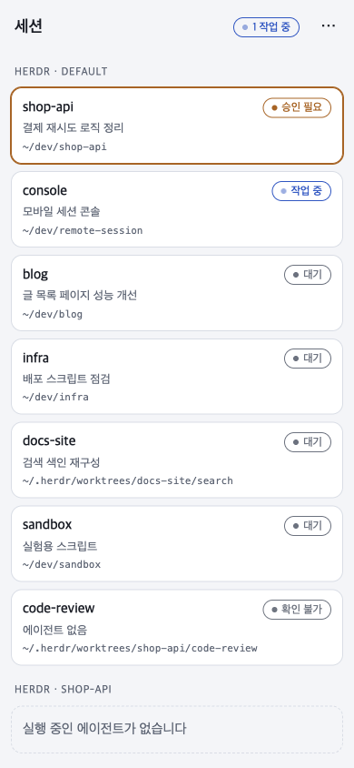
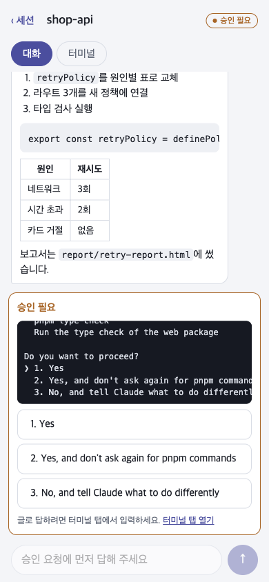
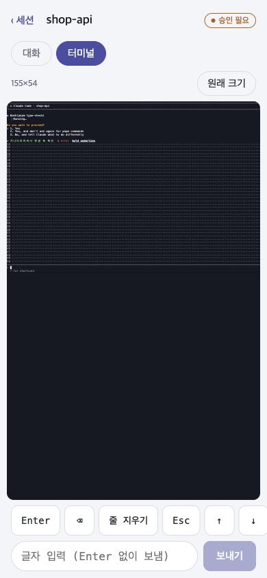
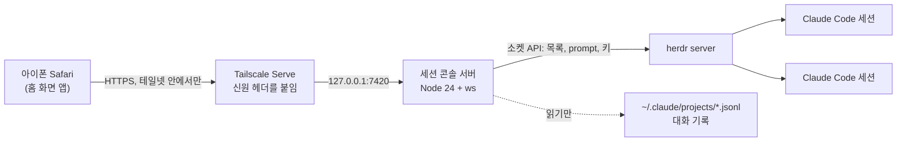
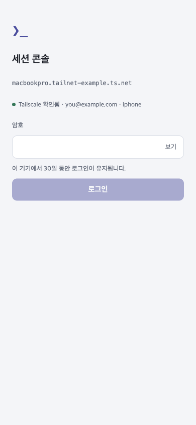
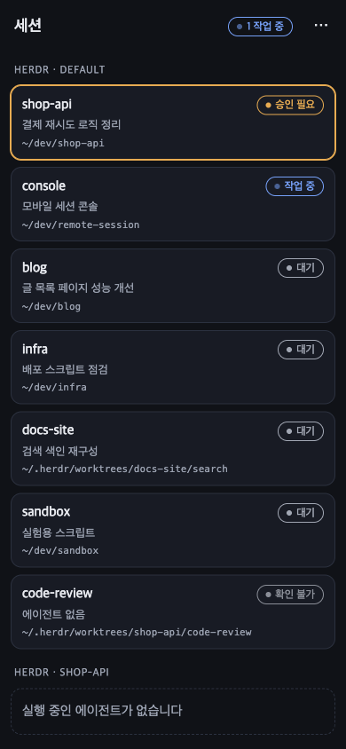
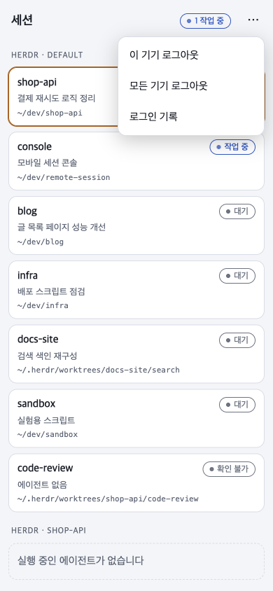
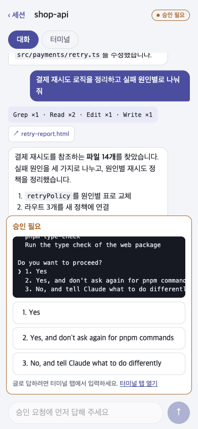
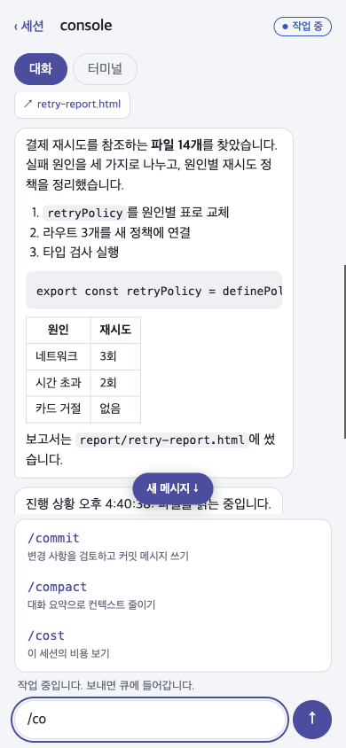
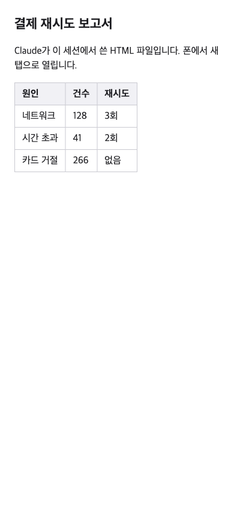

<h1 align="center">세션 콘솔</h1>

<p align="center">
  아이폰에서 Tailscale로 Mac에 접속해, 돌아가고 있는 Claude Code 세션을 고르고 작업을 이어서 하는 웹 콘솔입니다.<br>
  세션 목록을 보고, 대화를 보내고, 승인 요청에 답하고, 터미널 화면을 그대로 봅니다.
</p>

<p align="center">
  
  
  
  
</p>

<p align="center">
  &nbsp;&nbsp;
  &nbsp;&nbsp;
  
</p>

> 이 문서의 화면은 `web/mock`의 예시 데이터로 찍은 것입니다. 실제 화면에는 내 herdr 세션이 그대로 보입니다.

## 어떻게 동작하나

Mac에서 Claude Code 세션들은 [herdr](https://herdr.dev) 안에서 돌아갑니다. 이 콘솔은 herdr의 소켓 API로 세션 목록과 상태를 읽고, 메시지와 키 입력을 전달합니다. 대화 내용은 Claude Code가 남기는 transcript 파일에서 읽습니다. 폰은 Tailscale 테일넷 안에서만 접속할 수 있고, 들어온 뒤에도 암호를 맞혀야 화면을 볼 수 있습니다.



## 화면 안내

### 로그인



첫 화면입니다. 테일넷에 들어온 기기라도 암호 없이는 아무것도 볼 수 없습니다.

- **Tailscale 확인됨** 줄은 1차 관문을 통과했다는 표시입니다. Tailscale 계정과 기기 이름이 함께 보입니다.
- 아이디 입력란은 없습니다. 암호 하나만 넣습니다. iOS 키체인이 암호를 저장하고, 다음부터는 Face ID로 자동 완성합니다.
- 틀리면 "암호가 다릅니다. 남은 시도 n회."가 보입니다. 1분에 5번을 넘기면 버튼이 초를 세며 기다립니다.
- 로그인은 이 기기에서 30일 동안 유지됩니다. Safari를 완전히 닫았다가 열어도 다시 묻지 않습니다.
- 허용되지 않은 기기에는 로그인 화면 대신 "이 기기는 허용되지 않았습니다" 화면만 보입니다.

<br clear="all">

### 세션 목록

<table>
  <tr>
    <td></td>
    <td></td>
    <td></td>
  </tr>
  <tr>
    <td align="center">라이트</td>
    <td align="center">다크</td>
    <td align="center">메뉴</td>
  </tr>
</table>

herdr 세션(그룹)별로 묶어서 보여 줍니다. 한 줄에 워크스페이스 라벨, 상태, 제목, 짧은 경로가 있습니다.

| 상태 | 뜻 |
| --- | --- |
| **승인 필요** | Claude가 승인 대화상자나 질문을 띄우고 기다리는 중입니다. 목록 맨 위에 테두리를 강조해서 올립니다. |
| **작업 중** | Claude가 도구를 쓰거나 답을 쓰는 중입니다. 상단에 "N 작업 중" 요약이 붙습니다. |
| **대기** | 입력을 기다리는 중입니다. |
| **확인 불가** | 에이전트가 없거나 상태를 읽지 못했습니다. |

오른쪽 위 메뉴에는 **이 기기 로그아웃**, **모든 기기 로그아웃**, **로그인 기록**(최근 20건의 시각, 성공 여부, 기기 종류)이 있습니다. 다크 모드는 폰 설정을 따릅니다.

### 대화 탭

<table>
  <tr>
    <td></td>
    <td></td>
    <td></td>
  </tr>
  <tr>
    <td align="center">말풍선과 도구 묶음</td>
    <td align="center">승인 카드</td>
    <td align="center">슬래시 명령</td>
  </tr>
</table>

세션을 열면 기본으로 보이는 탭입니다. Claude Code의 대화 기록을 말풍선으로 보여 주고, 아래 입력창으로 다음 메시지를 보냅니다.

- **말풍선.** 내 메시지는 오른쪽, Claude의 답은 왼쪽입니다. 답은 마크다운으로 그립니다(목록, 코드, 표). 원문 HTML은 해석하지 않습니다.
- **도구 묶음.** 연속된 도구 호출은 `Grep ×1 · Read ×2 · Edit ×1` 같은 칩 하나로 접습니다. 누르면 각 호출의 요약이 펼쳐집니다.
- **산출물 링크.** Claude가 그 세션에서 HTML, SVG, 이미지, PDF 파일을 쓰면 도구 묶음 아래에 `↗ 파일 이름` 링크가 생깁니다. 누르면 새 탭에서 그 파일이 열립니다. 아래 "산출물 파일 보기"를 보세요.
- **승인 카드.** Claude가 승인을 기다리면 화면 아래에 원문 대화상자와 선택지 버튼이 뜹니다. 버튼을 누르면 그 번호가 Claude Code에 들어갑니다. `AskUserQuestion`의 선택지도 같은 방식으로 답합니다. 글로 답해야 하는 선택지("No, and tell Claude what to do differently")는 터미널 탭에서 입력합니다.
- **입력창.** 대기 중이면 바로 보내고, 작업 중이면 큐에 들어갔다고 알려 줍니다. 승인 요청이 떠 있는 동안에는 잠깁니다.
- **슬래시 명령.** 입력창에 `/`를 치면 그 세션에서 쓸 수 있는 명령 목록이 뜹니다. 프로젝트와 내 `~/.claude`의 스킬과 명령, 켜져 있는 플러그인, Claude Code 내장 명령을 모읍니다. 글자를 더 치면 앞글자가 같은 것부터 좁혀지고, 누르면 `/이름 `이 채워집니다.
- 새 답이 오면 맨 아래에 있을 때만 자동으로 따라갑니다. 위를 읽고 있으면 "새 메시지 ↓" 표시만 뜹니다.

### 터미널 탭


Mac에 떠 있는 Claude Code 화면을 그대로 봅니다. Mac 쪽 창 크기는 바꾸지 않습니다.

- 기본은 **폰 폭에 맞춰 축소**해서 화면 전체와 프롬프트 줄이 다 보입니다. 오른쪽 위 **원래 크기**를 켜면 1:1 크기에 가로 스크롤로 바뀝니다. 왼쪽 위에 실제 크기(예: 155×54)가 보입니다.
- **키 줄.** Enter, ⌫, 줄 지우기, Esc, ↑, ↓, Tab, Ctrl+C 순서입니다. ⌫는 한 글자를, 줄 지우기(Ctrl+U)는 입력줄 전체를 지웁니다. Ctrl+C는 한 번 누르면 2초 동안 다시 받지 않습니다. 빠르게 두 번 누르면 Claude Code가 종료되기 때문입니다.
- **글자 입력란.** 쓴 글을 Enter 없이 그대로 Claude Code 입력줄에 넣습니다. 보낸 뒤 Enter 버튼으로 확정합니다. 승인 대화상자에 글로 답할 때, `AskUserQuestion`에 직접 입력할 때 씁니다.
- 대화 기록이 아직 없는 새 세션(첫 메시지 전)은 대화 탭이 잠겨 있습니다. 이때는 터미널 탭에서 글자 입력과 Enter로 시작합니다.

<br clear="all">

### 산출물 파일 보기



Claude가 작업 중에 HTML 보고서나 그림을 만들면, 대화 탭의 링크로 폰에서 바로 엽니다.

- 열 수 있는 파일은 **그 세션의 Claude가 쓴 파일**뿐입니다. 서버가 transcript에서 쓴 기록을 확인한 뒤에만 보내 줍니다. 경로를 알아도 Mac의 다른 파일은 열리지 않습니다.
- 확장자는 `.html .htm .svg .png .jpg .jpeg .gif .webp .pdf`입니다.
- 열린 문서는 `sandbox` 정책 아래에서 돌아갑니다. 문서 안의 스크립트는 내 로그인으로 이 서버에 요청을 보낼 수 없습니다.

<br clear="all">

## 사용법

### 준비물

- macOS에서 `herdr server`가 돌아가고 그 안에 Claude Code 세션이 있어야 합니다. herdr 0.9 계열에서 확인했습니다.
- Node 24.18 이상, pnpm 11.
- Tailscale. 관리 콘솔에서 **MagicDNS**와 **HTTPS Certificates**를 켜 둡니다. Mac과 아이폰이 같은 테일넷에 있어야 합니다.

### 1. 설치

```sh
git clone https://github.com/sky629/remote-session.git
cd remote-session
pnpm install
```

### 2. 암호 만들기

터미널에서 직접 실행합니다. 암호는 화면에 보이지 않게 두 번 받습니다.

```
$ pnpm passphrase
설정 파일은 ~/.config/session-console/config.json입니다. Enter를 누르면 [ ] 안의 값을 그대로 씁니다.
소유자 Tailscale 계정 [you@example.com]:
공개 주소 [https://macbookpro.tailnet-example.ts.net]:
포트 [7420]:
herdr 실행 파일 [herdr]:
새 암호:
한 번 더 입력하세요:
암호를 저장했습니다. 기존 로그인 0개를 모두 무효로 했습니다.
```

- 기본값은 `tailscale status`에서 읽어 옵니다. 보통 Enter만 누르면 됩니다.
- 암호는 8자 이상이어야 하고 12자 이상을 권장합니다. 평문은 어디에도 저장하지 않고 scrypt 해시만 남깁니다.
- 다시 실행하면 암호가 바뀌고, 그동안 로그인한 기기는 모두 로그아웃됩니다.

### 3. 서버 켜기

```sh
pnpm start
```

웹을 빌드한 뒤 서버가 `127.0.0.1:7420`에서 뜹니다. 서버는 로컬에만 묶이고, 바깥으로 열리는 길은 다음 단계의 Tailscale Serve 하나뿐입니다.

### 4. Tailscale Serve 등록 (처음 한 번)

```sh
tailscale serve --bg 7420
tailscale serve status
```

App Store 판 Tailscale은 CLI가 `/Applications/Tailscale.app/Contents/MacOS/Tailscale`에 있습니다. `tailscale funnel`은 쓰지 않습니다. 이 콘솔은 테일넷 안에서만 열려야 합니다.

### 5. 아이폰에서 열기

1. Safari에서 `https://<Mac 이름>.<테일넷>.ts.net`을 엽니다. `tailscale serve status`에 나오는 주소입니다.
2. 암호를 넣고 로그인합니다. 키체인이 저장을 제안하면 저장해 둡니다.
3. 공유 버튼에서 **홈 화면에 추가**를 누르면 주소창 없는 전체 화면 앱으로 씁니다. 홈 화면 앱은 Safari와 로그인 저장소가 달라서 처음 한 번은 다시 로그인합니다.

### 로그아웃과 폐기

- 폰에서: 목록 메뉴의 **이 기기 로그아웃** 또는 **모든 기기 로그아웃**.
- Mac에서: `pnpm revoke-all`은 지금까지의 로그인을 모두 무효로 하고, 끊긴 기기의 종류와 로그인 시각을 출력합니다. 폰을 잃어버렸을 때 씁니다.
- `pnpm passphrase`를 다시 실행해도 모든 로그인이 무효가 됩니다.

### 개발

```sh
pnpm dev     # 서버(Tailscale 관문만 끔, 암호 관문은 유지) + Vite HMR, http://localhost:5173
pnpm check   # 타입 검사 + 서버 테스트 + 웹 테스트
```

herdr 없이 화면만 볼 때는 목업 서버를 씁니다. 암호는 `test-passphrase`입니다.

```sh
node web/mock/server.mjs                       # 127.0.0.1:7421
CONSOLE_SERVER=127.0.0.1:7421 pnpm exec vite web
```

## 보안

- 서버는 `127.0.0.1`에만 바인드합니다. Tailscale Serve만 앞에 둡니다.
- **1차 관문.** 모든 요청에서 Tailscale Serve가 붙이는 `Tailscale-User-Login` 헤더가 설정의 소유자와 같아야 합니다. 아니면 403이고, 암호를 시도할 기회도 없습니다.
- **2차 관문.** 암호는 scrypt(N=2^15, r=8, p=1)로 해시해서 저장합니다. 맞히면 32바이트 무작위 토큰을 `HttpOnly; Secure; SameSite=Strict` 쿠키로 주고, 서버에는 sha256만 남깁니다. 유효 기간은 30일입니다.
- 로그인 실패는 기기 주소마다 1분에 5회, 전체 1분에 20회까지만 받습니다.
- `POST /api/login`과 WebSocket 연결은 `Origin`이 설정의 공개 주소와 같아야 합니다.
- 폰에서 들어온 글은 셸을 거치지 않고 herdr 소켓 JSON으로만 전달합니다. 로그에 메시지 본문과 암호를 남기지 않습니다.
- 산출물 파일은 그 세션의 transcript에 쓴 기록이 있는 파일만, `sandbox` CSP를 붙여서 보냅니다.

## 구조

```
server/   Node 서버: 인증, herdr 어댑터, transcript 읽기, HTTP와 WebSocket
web/      Preact + Vite 폰 UI, xterm.js 터미널, web/mock 목업 서버
shared/   서버와 웹이 함께 쓰는 타입, 프로토콜, 오류표, 키 목록
docs/     설계 문서(docs/superpowers/specs)와 화면 캡처
```

설정과 상태는 `~/.config/session-console/`에 둡니다(`config.json`, `tokens.json`, `logins.jsonl`). 환경 변수 `SESSION_CONSOLE_DIR`로 위치를 바꿀 수 있습니다.

## 알아 둘 것

- herdr 안의 Claude Code 세션만 보입니다. cmux가 직접 띄운 세션은 1차 범위 밖입니다.
- 소유자 한 명을 위한 도구입니다. 계정이나 권한 구분은 없습니다.
- 서버는 전경에서 실행합니다. launchd 등록은 아직 없습니다.
- 폰에서 암호를 바꾸는 화면은 없습니다. Mac에서 `pnpm passphrase`를 다시 실행합니다.

설계 결정과 검증 기준은 [설계 문서](docs/superpowers/specs/2026-10-28-mobile-session-console-design.md)에 있습니다.
